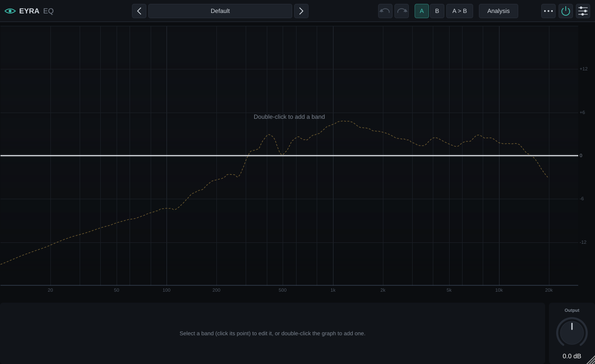

# EyraEQ

A professional parametric equalizer (VST3 + Standalone) with planned on-device intelligent
instrument detection and corrective EQ. The EQ is the product; the intelligent features are being
added on top of it in later phases and will always remain optional.

The full product specification lives in [DEVELOPMENT_PROMPT.md](DEVELOPMENT_PROMPT.md).



## Status

| Phase | Scope | Status |
|------:|-------|--------|
| 1 | Functional EQ: JUCE/CMake project, VST3 + Standalone, EQ engine, spectrum analyser, UI, presets, A/B, undo, bypass | **Done.** Builds, tests and pluginval (strictness 10) pass on Linux, macOS and Windows (see [testing report](Documentation/TestingReport.md)). |
| 2 | Audio analysis: problem-frequency and resonance detection, analysis buffer | Not started |
| 3 | Instrument recognition (ONNX Runtime, local model) | Not started. No model is included and none is claimed to work. |
| 4 | Intelligent corrective EQ generating real bands | Not started |
| 5 | Dynamic EQ, resonance suppression, advanced analyser options | Not started (M/S and per-band stereo placement were brought forward into Phase 1) |
| 6 | Installers (.exe, .dmg/.pkg, .AppImage/.deb), signing, DAW compatibility testing | Not started |

There is no intelligent-analysis panel in the UI yet: nothing is shown until it actually works.

## What works now (Phase 1)

**EQ engine**
- 24 bands (a compile-time constant; the engine is not tied to the number).
- Types: bell, low shelf, high shelf, high pass, low pass, notch, band pass, tilt.
- High / low pass slopes: 6, 12, 18, 24, 36, 48, 72 and 96 dB/oct, with resonance (Q) control.
- Per-band stereo placement: stereo, left, right, mid or side.
- Per-band bypass and solo (audition the band's region).
- Analogue-matched filter design in double precision: no bilinear "cramping" near Nyquist.
- Click-free: continuous parameters are smoothed; type / slope / placement changes and
  enable / bypass use a short S-curve crossfade. Measured transients stay at least 80 dB below the signal.
- Zero latency, no allocation or locking on the audio thread, denormal-safe.
- Input gain, output gain, master bypass (exposed to the host as its bypass parameter).

**Spectrum analyser**
- Pre-EQ (input) and post-EQ (output) spectra, each can be hidden.
- Resolution 2048–32768 points, speed, averaging, RMS or peak mode, peak decay, display
  slope (0 / 3 / 4.5 / 6 dB/oct), freeze.
- Lock-free audio-to-UI transfer; the analysis runs on the UI thread and can never stall audio.

**Interface**
- Spectrum-centred, resizable (860×520 up to 3200×2000) with size presets, HiDPI via JUCE.
- Double-click to create a band, drag nodes (Shift = fine), mouse wheel for Q, Shift-click or lasso
  for multi-select (selected bands move together), double-click a node to bypass, right-click for
  type / slope / placement / bypass / solo / delete, Delete key removes the selection.
- Band panel with type, frequency, gain, Q, slope, placement, bypass, solo and delete.
- Undo / redo (Ctrl/Cmd+Z, Ctrl/Cmd+Shift+Z), A/B comparison with copy, copy / paste of EQ
  settings (Ctrl/Cmd+C / V), reset.
- Presets: 14 factory starting points (plus an empty Default) and user presets (saved as `.eyrapreset` XML files).

## Building

Requirements: CMake 3.22+, a C++20 compiler, and Git (JUCE 9.0.6 is fetched automatically).

```bash
# Linux
Scripts/build-linux.sh          # Release build, unit tests and VST3 host test
# macOS (Universal)
Scripts/build-macos.sh
# Windows (Visual Studio 2022)
powershell -ExecutionPolicy Bypass -File Scripts\build-windows.ps1
```

To build offline against a local JUCE checkout, set `JUCE_DIR` (or `-JuceDir` on Windows).
Platform details, Linux package dependencies and plug-in install locations are in
[Documentation/Building.md](Documentation/Building.md).

## Testing

`ctest` runs two executables:
- `EyraEQTests`: filter accuracy and stability, engine behaviour (gain accuracy, sample rates,
  block sizes, M/S, clicks, solo, NaN/denormals), processor state, presets, undo, A/B, analyser
  calibration, and editor rendering.
- `EyraEQHostTest`: loads the built `EyraEQ.vst3` through JUCE's VST3 hosting layer and checks
  scanning, layouts, host parameters, processing, state restore, editor, bypass and repeated
  load / unload.

CI (`.github/workflows/build.yml`) also runs [pluginval](https://github.com/Tracktion/pluginval) at
strictness 10 on all three platforms.

## Project layout

```
Source/
  DSP/          filter design, band, engine (no JUCE GUI dependencies)
  Analysis/     analyser FIFO and spectrum analyser
  Parameters/   parameter layout and lock-free parameter reader
  State/        presets, undo history, A/B
  UI/           look and feel, spectrum display, band panel, top bar
  PluginProcessor.*, PluginEditor.*
Resources/FactoryPresets/   generated by Scripts/generate_factory_presets.py
Tests/          unit tests and the VST3 host test
Scripts/        build scripts
Documentation/  architecture, DSP, building, testing report
```

## Licensing notes

EyraEQ depends on [JUCE](https://juce.com), which is dual-licensed under the **AGPLv3** and the
commercial JUCE licence. Distributing EyraEQ therefore requires either releasing it under terms
compatible with the AGPLv3 or holding a JUCE licence. JUCE bundles the Steinberg VST3 SDK (MIT
licence). No licence has been chosen for EyraEQ's own code yet; that decision is the owner's.

"VST" is a trademark of Steinberg Media Technologies GmbH.
